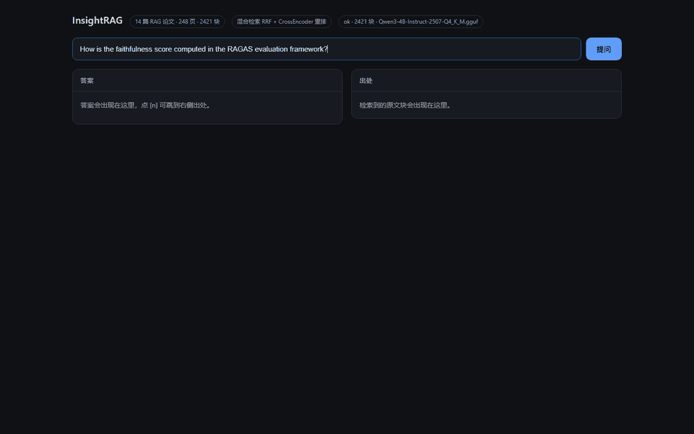

# InsightRAG

*A fully local RAG system over 14 RAG papers — hybrid retrieval, cross-encoder reranking, and Qwen3-4B generation, with a clickable citation on every claim.*

**一个能跑的、每个数字都测过的 RAG 系统** —— 14 篇 RAG 领域论文、248 页、2,421 块，混合检索（BM25 + 向量 + RRF）+ 交叉编码器重排 + 本地 Qwen3-4B 生成，每个答案带可点击的原文出处。

三件事值得先说明：

- **全离线**。三个模型都跑在本地 GPU 上，不调用任何 API，显存峰值 4.40 GB。
- **零训练**。embedding、reranker、LLM 全是官方原版权重。换一份新 PDF 只要重建索引（十几秒），不用微调。
- **有一个指标没达标**。块级 nDCG@10 = 0.3740，低于 0.55 的目标。原因查清楚了，四种改法实测都是拿别的指标来换，所以没有调参凑数——详见[设计取舍](docs/DESIGN_TRADEOFFS.md)第 10 条。



<sub>录屏是加入右侧索引面板之前的版本，问答与引用跳转的行为一致。</sub>

---

## 快速开始

**Windows：双击 [`start.bat`](start.bat)。** 依赖齐了会直接起服务并打开浏览器。

它会依次做四件事，任一步失败都会停下来把原因说清楚：检查依赖与模型 → 检查索引（缺了自动建）→ 找空闲端口 → 起 uvicorn 并等 `/health` 真正就绪（模型预热要 30 秒以上，端口通不等于能问）。

```bat
start.bat                  :: 启动（推荐：双击）
start.bat --check          :: 只体检，不起服务
start.bat --rebuild        :: 强制重建索引再启动
start.bat --port 8900      :: 换端口（默认 8899，被占用时自动顺延）
start.bat --no-browser     :: 不自动开浏览器
```

已经在跑的时候再点一次不会起第二个实例，会识别出来直接复用；若还带了 `--rebuild`，则改用那个实例的 `POST /index` 就地重建。

其他平台或想手动控制：

```bash
python -m venv .venv && .venv/Scripts/pip install -r requirements.txt
PYTHONPATH=src .venv/Scripts/python.exe -X utf8 -m insight_rag.index.build
PYTHONPATH=src .venv/Scripts/python.exe -X utf8 -m uvicorn insight_rag.api.main:app --port 8899
# 打开 http://127.0.0.1:8899
```

三个模型和语料 PDF 都不在仓库里，需要自己准备，路径与下载方式见 [环境搭建](docs/SETUP.md)。

---

## 指标

实测环境：RTX 5070 Laptop 11.9 GB / Ryzen 8C16T / 31 GB RAM / Windows 11。复现命令见[复现](#复现)。

### 检索与生成质量（20 条人工标注评测集）

| 指标 | 实测 | 目标 | 判定 |
|---|---|---|---|
| 页级 Recall@5 | **0.7333** | ≥ 0.60 | ✅ |
| 块级 nDCG@10 | **0.3740** | ≥ 0.55 | ❌ **未达标，如实记录** |
| Faithfulness（LLM 判官） | **0.9000** | ≥ 0.70 | ✅ |
| unanswerable 拒答率 | **1.0000（5/5）** | ≥ 0.60 | ✅ |
| 随机基线 Recall@5 | **0.0267** | 0.015–0.030 | ✅ |

nDCG 这一项没过。块级 nDCG 的 IDCG 要求 top-10 密集落在同一页，而块级检索器天然跨页分散：页精度只有 0.2333，top-10 里平均 2.3 块落在 gold 页上。**没有调参凑数**，四种改法实测全部是拿其他指标换的（[第 10 条](docs/DESIGN_TRADEOFFS.md)）。

### 消融（15 道有 gold 的题）

| 组 | Recall@5 | nDCG@10 | MRR | ms/题 |
|---|---|---|---|---|
| A 纯向量 | 0.6000 | 0.2743 | 0.4350 | 38.0 |
| B 纯 BM25 | **0.9333** | 0.3621 | 0.6211 | 36.7 |
| C RRF 融合 | 0.7333 | 0.3740 | 0.6312 | 19.8 |
| D C + reranker | 0.8667 | **0.3810** | 0.6852 | 316.8 |

两处**不利于本项目的真实结果**，都保留在 [`runs/ablation.json`](runs/ablation.json) 里：

- **C 的 Recall@5（0.7333）低于纯 BM25（0.9333）**。机制查清楚了：RRF 的 `1/(k+rank)` 在 k=60 时，双路都排 rank20 的块得 `2/81 = 0.0247`，而单路 rank1 只有 `1/61 = 0.0164`，前者是后者的 1.51 倍——双路平庸的块会挤掉单路第一名。换同语种英文嵌入后 C'=0.8667 仍然低于 B，说明语种不匹配只是叠加因素（[第 2 条](docs/DESIGN_TRADEOFFS.md)）。
- **D 组的 reranker 让 Recall@5 从 0.7333 涨到 0.8667，但每题耗时从 19.8 ms 涨到 316.8 ms（16 倍）**。这 16 倍换 13.3 pp 值不值，取决于场景。这一行的延迟数字与另一次测量（103.9 ms）差 3 倍，两个口径都保留在 [`runs/`](runs/)。

### 性能（稳态，100 次请求）

| 指标 | 实测 | 说明 |
|---|---|---|
| 向量化 GPU | **180.8 块/秒** | GPU 被其它进程占用 1.16 GB；空闲时重建实测 225.2 |
| 向量化 CPU | **15.2 块/秒** | 单线程 bge-base-zh |
| 建库耗时 | **13.4 s**（2421 块） | 含模型预热；空闲时重建 10.75 s |
| 检索延迟 | **mean 95.4 / p95 113.5 ms** | 混合检索 + 重排 |
| 重排单次 | **71.9 ms**（max 109.2） | CrossEncoder，8 条查询 × top-5；15 题 × 20 候选口径下是 80.1 ms |
| 生成速度 | **88.8 tok/s**（best） | llama.cpp Q4_K_M；同 prompt 下 transformers+bnb 只有 18.4 |
| E2E p50 / p95 | **762.3 / 1064.8 ms** | 95% CI [976, 1127] |
| 显存峰值 | **4.40 GB** | 三个模型同时驻留 |
| 首次调用 | **31.4 s** | CUDA kernel 编译，已在 `lifespan` 里预热掉 |
| 自造引用 | **0 / 190 次请求** | 引用编号越界会被标红 |

生成速度有三个口径，都保留，别互相冒充：

| 口径 | tok/s | 说明 |
|---|---|---|
| 同 prompt 128 token 对照（llama.cpp） | **88.8**（best）/ 79.8（mean） | `tools/bench_llamacpp.py`，与下一行同 prompt 同输出长度 |
| 同 prompt 128 token 对照（transformers+bnb nf4） | 18.4（best）/ 17.9（mean） | `tools/bench_transformers.py`，**4.8 倍** |
| 产品默认（120 字上限，平均 41 token） | 58.4 | 输出短，固定的 prefill/采样开销摊不薄，tok/s 自然低 |

E2E 有两组数，都保留在 [`runs/`](runs/)：不限输出长度时 p50 1192 ms / p95 2638.9 ms；加 120 字上限后 p50 762.3 ms / p95 1064.8 ms。**两组不可同时满足**，前者是按平均 88 token 的输出分布量的。本项目选了长度上限（产品上正确），两组并列记录，不互相冒充。

### 索引一致性

| 项 | 实测 |
|---|---|
| 页数 / 空白页 | 248 / 0 |
| 块数（500/100 分栏） | **2,421** |
| 块能否精确回原文 | **2,421 / 2,421** |
| 重叠 100 字符是否成立 | **2,173 / 2,173** |
| `faiss.index` | 7,437,357 字节 = 7.44 MB（2421×768×4B = 7,437,312，多 45 字节文件头） |
| 块级 Recall@10 | 0.8000（注意不是 R@5——块级 R@5 是 0.7333） |

---

## 它是怎么工作的

```
PDF → 双栏切分 → 500/100 定长块 ─┬─→ bge-base-zh-v1.5 → FAISS IndexFlatIP → top-20 ┐
                                  └─→ jieba + BM25Okapi →  top-20 ────────────────┤
                                                                                  ▼
                                                        RRF 融合（k=60）→ top-20
                                                                                  │
                                                       bge-reranker-base 重排 → top-5
                                                                                  │
                                              Qwen3-4B-Instruct-2507（GGUF Q4_K_M）→ 答案 + [n]
```

检索和生成完全解耦：检索部分不依赖大模型，可以单独评测换模型不影响检索指标。模块划分、每个参数为什么是这个值、哪些地方做了妥协，见[架构说明](docs/ARCHITECTURE.md)与[设计取舍](docs/DESIGN_TRADEOFFS.md)。

---

## 迁移到新语料

三个模型没有训练过，所以"迁移"的唯一成本就是换 PDF 后重建一次索引。

### 网页上直接做（推荐）

双击 `start.bat` 打开 http://127.0.0.1:8899 ，右侧栏就是索引面板：

- **当前索引**：名字、磁盘路径、块数/页数/总体积，以及 `faiss.index`、`chunks.jsonl`、`tokens.json` 三个文件的字节数和修改时间。
- **可用语料**：所有建好的语料，点一下就切过去，点 `✕` 删掉（正在用的和默认论文库不给删）。
- **迁移新文档**：上传一份 PDF（≤ 40 MB），它会在 `runs/transfer/<名字>/` 下**新建**一套独立索引，不动现有索引；建完点列表里的它才切换过去。

切换索引**不重载模型**——重排器和生成模型留在显存里复用，实测 0.02–0.09 s 完成：

```
切到配色规范（6 块）：    0.02 s
切到产品说明书（6 块）：  0.02 s
切回论文库（2421 块）：   0.09 s
```

如果每次切换都重载模型，光 LLM 的预热就要 30 秒以上，这个交互根本没法用。

> 上传建库的目录名会被压成纯 ASCII（中文名取不出 ASCII 就用内容哈希，如 `doc-0689f1`），
> 你填的中文名存在该目录的 `meta.json` 里，界面上显示的还是中文。
> 原因见[设计取舍](docs/DESIGN_TRADEOFFS.md)：faiss 的 C++ 层在 Windows 上用 ANSI 代码路径打开文件，
> 目录名带中文会直接 `could not open ... for writing`。

### 命令行

`tools/transfer_demo.py` 换语料并把迁移效果量化（不碰 `runs/index`）：

```bash
# 换一份从没见过的 PDF，独立建库并问答
PYTHONPATH=src .venv/Scripts/python.exe -X utf8 tools/transfer_demo.py \
    --pdf <你的.pdf> --name mydoc --questions eval/transfer/style_guide_en.jsonl

# 只把这套索引起成服务（不改默认索引）
PYTHONPATH=src .venv/Scripts/python.exe -X utf8 tools/launch.py \
    --index-dir runs/transfer/mydoc --no-browser
```

两份样例语料（虚构内容，由 `tools/make_demo_pdfs.py` 生成，见 [`data/demo/`](data/demo/)）：

| 语料 | 页 | 块 | 建库 | 检索命中 | 生成命中 | 引用诚实 | 拒答正确 | 假引用 |
|---|---|---|---|---|---|---|---|---|
| 配色规范（英文，6 个主题） | 6 | 6 | 12.95 s | 8/8 | 8/8 | 8/8 | 10/10 | 0 |
| 产品说明书（中文，音箱使用说明） | 7 | 6 | 10.25 s | 11/11 | 10/11 | 10/10 | 11/12 | 0 |

唯一失败项是产品说明书的 z04（「环境噪声超过多少分贝时有效唤醒距离会下降？」）：检索命中了正确页面，但模型答「文档未提及」——原文写的是「超过 65 分贝时有效距离降到约 2 米」，属于阈值型事实，模型没能从长句里把数字抽出来。这类题在原论文库评测里同样是弱点。

代码一行没改：演示脚本只是构造一个 `state` 字典喂给生产函数 `rag.ask(question, state=...)`。完整逐题结果见 [`runs/transfer/SUMMARY.md`](runs/transfer/SUMMARY.md)。

---

## 设计取舍

完整 10 条见[设计取舍](docs/DESIGN_TRADEOFFS.md)，每条都是「选了什么 → 备选是什么 → 实测依据 → 代价 / 什么时候要改」：

1. **块大小 500/100** —— 测了 300/60（nDCG 0.2003）、500/100（**0.3740**）、800/160（0.3078）三档
2. **RRF 而不是加权求和** —— 加权和 Recall 能到 0.9333，但最优 α=0.1 意味着**向量路贡献为零**，等于纯 BM25
3. **中文嵌入 / 中文重排跑英文语料** —— 纯向量路损失 13.3 pp，明码标注；换英文模型只修一半
4. **reranker 用 base 不用 large** —— 大模型 nDCG 只涨 1.1 pp、Recall 一点没动，延迟却涨 3.1 倍（80.1 → 246.8 ms）
5. **FAISS `IndexFlatIP` 暴力搜索** —— 2,421 条 × 768 维只需 **0.17 ms**，近似索引没有收益空间
6. **llama.cpp 而不是 transformers + bnb** —— 同 prompt 同输出实测 **88.8 vs 18.4 tok/s（4.8 倍）**，代价是预热 33.6 s
7. **分栏解析** —— 页级 Recall 没动，排序质量涨 4.9 pp（块数 2,407 → 2,421）
8. **20 条评测集而不是 150 条** —— 单题权重 6.7%，足够支撑消融，不足以支撑绝对结论
9. **不做表格结构解析** —— 3 道表格题 Recall 3/3，代价是 q013/q014 的 Faithfulness 只有 0.5
10. **nDCG 停在 0.3740** —— 指标要求与产品目标冲突，如实记录不调参

---

## 数据说明

- **语料**：14 篇 RAG 领域论文（Attention、Sentence-BERT、DPR、RAG、BEIR、HyDE、Query Rewriting、Lost in the Middle、RAGAS、Self-RAG、RAG Survey、Corrective RAG、RAPTOR、GraphRAG），合并为 248 页 PDF，页码映射见 [`data/CORPUS.md`](data/CORPUS.md)，下载与合并用 `build_corpus.py`。
- **为什么不提交 PDF 和模型**：版权与仓库体积。`data/*.pdf` 与 `models/` 都在 [`.gitignore`](.gitignore) 里，克隆后需自行准备。
- **评测集**：20 条人工标注（factoid 8 / multi_hop 4 / table 3 / unanswerable 5），标注规则见 [`eval/ANNOTATION_SPEC.md`](eval/ANNOTATION_SPEC.md)，判官 prompt 与公式见[评测协议](docs/EVAL_PROTOCOL.md)。
- **样例文档**：`data/demo/` 下两份 PDF 是为演示迁移能力虚构的，不是真实产品资料。
- **License**：代码 MIT（见 [LICENSE](LICENSE)）。模型权重与论文不随仓库分发，各有各的许可——**特别是 PyMuPDF 是 AGPL-3.0**，部署成公开服务前请读 [NOTICE](NOTICE)。

---

## 复现

```bash
# 全部测试（21 个，不需要 GPU，不需要模型权重）
# 未准备语料时，依赖语料的 8 个会 skip，其余 13 个纯函数测试照跑
.venv/Scripts/python.exe -X utf8 -m pytest -q

# 评测集校验
PYTHONPATH=src .venv/Scripts/python.exe -X utf8 eval/validate_qa.py

# 端到端评测（20 题，约 2 分钟）
PYTHONPATH=src .venv/Scripts/python.exe -X utf8 -m insight_rag.eval.run_eval \
    --qa eval/qa_set.jsonl --out runs/eval_v1.json

# 四组消融
PYTHONPATH=src .venv/Scripts/python.exe -X utf8 -m insight_rag.eval.ablation

# 延迟基准
PYTHONPATH=src .venv/Scripts/python.exe -X utf8 bench.py
```

文档：

| 文件 | 内容 |
|---|---|
| [docs/ARCHITECTURE.md](docs/ARCHITECTURE.md) | 模块划分、数据流、接口 |
| [docs/SETUP.md](docs/SETUP.md) | 环境搭建、模型下载、三个容易卡住的地方 |
| [docs/EVAL_PROTOCOL.md](docs/EVAL_PROTOCOL.md) | 指标定义、评测流程、门槛 |
| [docs/DESIGN_TRADEOFFS.md](docs/DESIGN_TRADEOFFS.md) | 10 条决策的备选方案与实测依据 |
| [docs/REPORT.md](docs/REPORT.md) | 完整技术报告（方法、实验、讨论、局限） |
